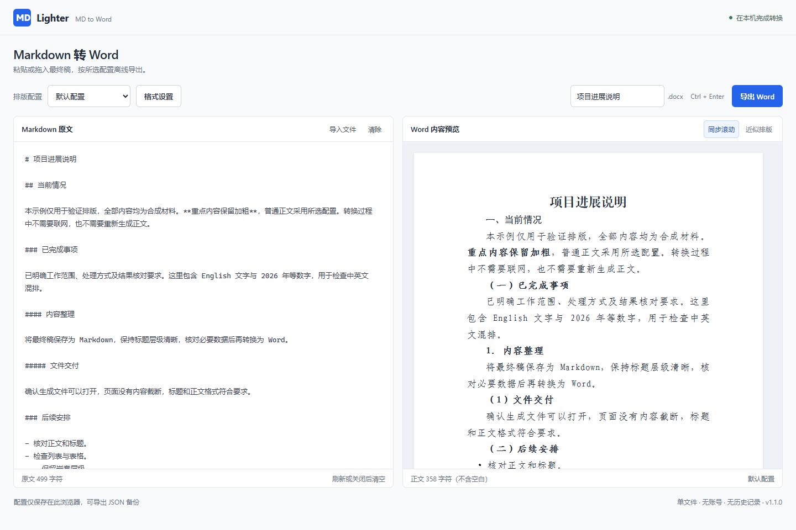

# Lighter · MD to Word

**One HTML file. Offline Markdown to editable Word.**

[中文](./README.md) · [English](./README.en.md)

A self-contained HTML app of about **0.67 MB**: download, double-click, paste Markdown, and export `.docx`. Also includes a prebuilt CLI for local AI assistants, Skills, and scripts: **~0.27 MB download**, ~1.25 MB entry after extraction.

The browser interface currently uses Chinese labels; this guide documents both entry points in English.

**[Download HTML](https://github.com/BBS6215/lighter-md-to-word/raw/refs/heads/main/md2word.html)** · **[Download portable CLI](https://github.com/BBS6215/lighter-md-to-word/raw/refs/heads/main/downloads/lighter-md-to-word-cli.zip)** · [AI integration guide (Chinese)](./docs/skill-integration.md)



## Two entry points, one converter

| Workflow | What you need | Runtime |
|---|---|---|
| Paste / import / preview / export | Only `md2word.html`, ~0.67 MB | Desktop Chrome or Edge; no Node.js, Git, or installer |
| Local AI / Skill / automation | CLI ZIP includes `cli/md2word.mjs`, `md2word.cmd`, a bilingual quick start, and licenses | **Node.js 22.12+**; no pnpm, npm install, or build step |

Version **1.1.0**. The product name is **Lighter · MD to Word**. The repository and local project directory are named `lighter-md-to-word`; HTML filenames and the `md2word` command remain compatible. Development `node_modules` are not distributed.

## Start in three steps

1. Download the HTML file above as `md2word.html`. If your browser displays its source, use Save As.
2. Open it locally. Paste Markdown or import / drop a UTF-8 `.md`, `.markdown`, or `.txt` file.
3. Pick a profile, check the preview, and click **导出 Word** (Export Word). **格式设置** opens formatting settings. `Ctrl+Enter` also works.

**Share just the HTML file** with someone who wants the browser app. Scripts, CSS, icon, and runtime dependency licenses are embedded. Conversion needs no server, account, remote assets, or uploads.

The desktop panes follow approximately the same source block in either direction. Sync pauses in single-column layouts. A4 preview fits the panel; long paragraphs, tables, and code use approximate within-block mapping. Final pagination is determined by Word / WPS.

Input remains in the current page's memory and clears on reload or close. There is no persisted document history. Clear can be undone for six seconds; new input cancels the old undo snapshot. Source files remain unchanged. Fonts are not embedded; missing fonts may be substituted on another computer.

## Chinese official-document typography

Supports Chinese official-document-style headings, body text, hierarchical numbering, first-line indents, fixed line spacing, and page numbers. Font and heading conventions draw on **GB/T 9704—2012, Layout key for official document of Party and government organs**. [Official standard information](https://openstd.samr.gov.cn/bzgk/std/newGbInfo?hcno=F3CC9BEF482524C895FDA7A08BB4A70E)

**The current default profile is customizable, not a complete GB/T 9704 compliance template.** For example, its top margin is 25.4 mm, left margin 31.75 mm, and page numbers are centered Arabic numerals; the standard specifies other page-area and page-number arrangements. The app does not generate agency letterheads, issuance numbers, seals, publication blocks, printing or binding requirements, or guarantee 22 lines per page and 28 Chinese characters per line. Check formal issuances against the applicable institutional template. [Government layout guidance](https://www.zyx.gov.cn/Content-1778525.html)

### Default formatting

| Element | Default |
|---|---|
| Page | A4; top/bottom 2.54 cm, left/right 3.175 cm |
| Document title | 方正小标宋简体, 22 pt, centered, regular, no indent |
| First-level heading | 黑体, 16 pt, regular |
| Second-level heading | 楷体_GB2312, 16 pt, bold |
| Third-/fourth-level heading | 仿宋_GB2312, 16 pt, bold |
| Body | 仿宋_GB2312, 16 pt, justified |
| Paragraphs | Fixed 28 pt spacing, no before/after spacing; two-character first-line indent except the document title |
| Page numbers | Centered Arabic numerals, start at 1, 9 pt |

`#` is the document title. `##` through `#####` map to `一、`, `（一）`, `1.`, and `（1）`. Missing numbering is added; authored numbering is retained and participates in counting. New parents reset their children. Irregular sequences produce warnings rather than rewriting your text.

## Up to three reusable profiles

Keep one editable default profile and up to two named profiles. Valid settings attempt to persist in the current browser. Profiles contain formatting only, never document content, filenames, or conversion history. The sync toggle is a separate UI preference.

Moving the HTML file, switching browsers, or clearing browser data may affect local settings. Export JSON as a backup. Storage failure still permits Word and JSON downloads.

To hand browser formatting to a local AI assistant:

1. Adjust the settings in the HTML app and export the profile JSON.
2. Import that downloaded file with `profiles import` below.
3. Repeat only when the formatting changes.

**The browser remembers its last selection. The CLI / AI always uses `default` unless explicitly told otherwise.** Downloading JSON does not synchronize the CLI. Existing valid `schemaVersion: 1` profiles remain compatible.

## Prebuilt CLI: install Node.js, then run

Install [Node.js](https://nodejs.org/en/download) 22.12 or newer first. Check your version with `node --version`.

Download and extract the complete CLI ZIP above, keeping its directory structure. `cli/md2word.mjs` bundles the converter and uses only Node.js built-ins as external imports. No project dependency installation, compilation, HTML window, or background service is needed. Windows is tested; other operating systems have not been validated.

```powershell
# Windows, from the extracted directory:
.\md2word.cmd convert --input "D:\Documents\final draft.md"

# Inspect profiles / import settings exported by the HTML app:
.\md2word.cmd profiles list
.\md2word.cmd profiles import --input "D:\Downloads\profiles.json"

# Explicit output path and an already imported profile:
.\md2word.cmd convert --input "D:\Documents\final draft.md" --output "D:\Documents\delivery.docx" --profile "Meeting notes"

# Direct Node invocation, without the Windows wrapper:
node ./cli/md2word.mjs convert --input "./final.md"
```

By default, Word is written beside the Markdown file. Existing Word files are never overwritten: duplicate names become `name (2).docx`. Personal settings live at **the tool root** `.local/profiles.json`, independent of the caller's working directory. `--config` selects another configuration file. Missing implicit personal settings use built-in defaults with a warning; corrupt settings, unknown profiles, invalid UTF-8, and forbidden XML characters fail explicitly.

Successful commands print one JSON line to stdout. Failures print error JSON to stderr and exit nonzero. Results include `ok`, `outputPath`, profile details, stats, and `warnings`, never document content. Full help: `node ./cli/md2word.mjs --help`.

## AI-ready: pass a path, not the document again

**Your model writes the content; the CLI performs deterministic conversion.** A local assistant with shell access can pass an existing final Markdown file directly to the CLI, without regenerating the full text or writing document-generation code. The converter makes no model API calls and requires no API key, MCP, or persistent service. The assistant's reasoning, Skill loading, and tool calls still have their own context costs.

A reusable instruction:

> Use my installed Lighter · MD to Word to convert the specified final Markdown. Run cli/md2word.mjs from its actual installation path; pass the file path and use default unless I explicitly select a profile. Check the exit code, JSON ok field, and that outputPath exists, then return the real Word link and relevant warnings. Do not rewrite the source or silently change profiles.

PowerShell example from another working directory:

```powershell
& node "D:\Tools\Lighter\cli\md2word.mjs" convert --input "D:\Documents\final draft.md"
```

Optionally install a thin `md2word` Skill. **After installation**, invoke it with `$md2word` in Codex or `/md2word` in Claude Code, followed by the final file path. A natural-language request can also select the Skill. Downloading this repository does not install a Skill: set its CLI path to the actual local installation. A portable template and integration contract are in [the integration guide (Chinese)](./docs/skill-integration.md).

## Supported content and validation

Headings, emphasis, links, nested lists, tasks, basic tables, and code are supported. Relative or unsupported links remain plain text with their destinations. Images become alt-text placeholders; no image resources are loaded. Math stays as source text. Complex HTML is not executed and produces warnings. Standalone `<br>` creates blank lines; thematic breaks are removed for this document style while ordinary hyphens and tables remain intact. Forbidden XML characters block export with a location message.

Version 1.1.0 passed 72 regression tests, relevant Chrome / Edge checks, real browser downloads, OOXML validation, WPS opening, and rendered-page inspection. The prebuilt distribution receives additional checks outside the source tree and without node_modules. See [validation records (Chinese)](./docs/validation.md) for exact coverage and platform limits.

## Build from source

Only developers changing or rebuilding the app need project dependencies:

```powershell
corepack pnpm install --frozen-lockfile
corepack pnpm check
```

The build writes `md2word.html`, the distributed `cli/md2word.mjs` and `downloads/lighter-md-to-word-cli.zip`, and the compatible development entry `build/cli.js`. CI checks that committed artifacts rebuild consistently. [Architecture (Chinese)](./docs/architecture.md) · [Validation (Chinese)](./docs/validation.md)

## License

[MIT](./LICENSE). See [third-party notices](./THIRD_PARTY_NOTICES.md) and [license texts](./THIRD_PARTY_LICENSES.txt). Runtime license texts are embedded in both HTML and CLI. Font files, personal profiles, real documents, and converted outputs are not distributed.
