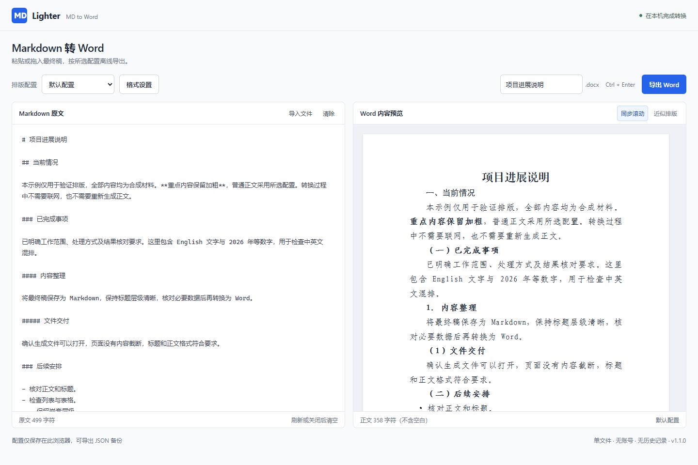

# Lighter · MD to Word

**一个 HTML，把 Markdown 变成可编辑的 Word。**

[中文](./README.md) · [English](./README.en.md)

单文件约 **0.67 MB**，下载后双击即用。离线转换、正文不上传、最多三套排版配置。另提供预打包 CLI（下载包约 **0.27 MB**，解压后入口约 1.25 MB），供本地 AI、Skill 和脚本直接调用。

**[下载 HTML](https://github.com/BBS6215/md2word-local/raw/refs/heads/main/md2word.html)** · **[下载 CLI 便携包](https://github.com/BBS6215/md2word-local/raw/refs/heads/main/downloads/lighter-md-to-word-cli.zip)** · [AI 接入说明](./docs/skill-integration.md)



## 两种入口，同一套排版

| 使用方式 | 拿到什么 | 需要什么 |
|---|---|---|
| 手动粘贴、拖入、预览、导出 | 一个 `md2word.html`，约 0.67 MB | 桌面 Chrome / Edge；无需 Node.js、Git 或安装程序 |
| 本地 AI / Skill / 脚本调用 | CLI ZIP 内有 `cli/md2word.mjs`、`md2word.cmd`、双语快速说明和许可文件 | Node.js **22.12 或更新版本**；无需 pnpm、`npm install` 或自行构建 |

当前版本 **1.1.0**。对外名称为 **Lighter · MD to Word**；仓库、文件名和短命令继续使用 `md2word-local` / `md2word`，保持现有调用兼容。开发目录里的 `node_modules` 不随下载分发。

## 普通使用：下载 → 双击 → 导出

1. 点击上方“下载 HTML”，保存为 `md2word.html`。若浏览器只显示源码，使用“另存为”保存文件。
2. 双击打开，粘贴 Markdown，或导入 / 拖入 UTF-8 的 `.md`、`.markdown`、`.txt`。
3. 选择排版配置，核对预览，点击“导出 Word”；也支持 `Ctrl+Enter`。

分享给朋友时，**只发这个 HTML 即可**。图标、脚本、样式和依赖许可均在文件内，无需联网加载资源。

桌面原文与预览可双向跟随同段内容；手机等单栏布局自动暂停同步。预览适应面板宽度，长段落、表格和代码块内部为近似跟随，最终分页以 Word / WPS 为准。

正文在当前页面内存中保留，刷新或关闭后清空，不写入历史记录；清除后 6 秒内可撤销，输入新内容后旧稿撤销失效。源 Markdown 不被改写。字体文件不内嵌，接收电脑缺少所选字体时可能替换。

## 中文公文材料排版

支持公文材料常用的标题、正文、层级编号、首行缩进、固定行距和页码；字体及层级处理参考 **GB/T 9704—2012《党政机关公文格式》**中的相关做法。[国家标准官方信息](https://openstd.samr.gov.cn/bzgk/std/newGbInfo?hcno=F3CC9BEF482524C895FDA7A08BB4A70E)

**这是一套可自定义的公文材料排版工具，当前默认配置并非完整的国标公文模板。**例如本工具默认上边距 25.4 mm、左边距 31.75 mm、居中数字页码；标准版心与页码另有规定。工具不自动编排红头、发文字号、印章、版记或印制装订，也不保证每页 22 行、每行 28 字。正式发文应按本单位模板及相应要求核对。[公文版式要求参考](https://www.zyx.gov.cn/Content-1778525.html)

### 当前默认配置

| 项目 | 默认值 |
|---|---|
| 页面 | A4；上下边距 2.54 cm，左右 3.175 cm |
| 大标题 | 方正小标宋简体，二号 22 磅，居中，不加粗、不缩进 |
| 一级标题 | 黑体，三号 16 磅，不额外加粗 |
| 二级标题 | 楷体_GB2312，三号，加粗 |
| 三级、四级标题 | 仿宋_GB2312，三号，均加粗 |
| 正文 | 仿宋_GB2312，三号，两端对齐 |
| 段落 | 固定行距 28 磅，段前段后 0；正文及各级标题首行缩进 2 字符，大标题不缩进 |
| 页码 | 居中阿拉伯数字，从 1 开始，9 磅 |

`#` 为大标题；`##`、`###`、`####`、`#####` 分别对应“一、”“（一）”“1.”“（1）”。缺少编号时补齐，已有编号保留并参与计数，上级变化后下级重新开始；异常顺序提示核对，不改写材料内容。

## 保存三套配置 / 交给 AI

默认配置可调整、恢复，不可删除；另可创建两套命名配置。合法设置自动尝试保存在当前浏览器。正文、文件名和转换历史不进入配置；同步开关也是独立的 UI 偏好。

移动 HTML、清理浏览器数据或换浏览器可能影响本地配置，建议导出 JSON 备份。存储不可用时，本次仍可导出 Word 和配置 JSON。

把网页格式交给本地 AI：

1. 在 HTML 的“格式设置”中调整并“导出 AI 配置（JSON）”。
2. 用下方 `profiles import` 命令导入这个文件。
3. 以后只在排版配置变化后重新导入。

**HTML 记住上次选择；CLI / AI 不指定时固定用 `default`。JSON 下载不代表 CLI 已同步。**配置仍使用 `schemaVersion: 1`，1.0.x 的合法配置继续可用。

## CLI：下载即有成品，安装 Node.js 后运行

先安装 [Node.js](https://nodejs.org/en/download) 22.12 或更新版本，可运行 `node --version` 查看本机版本。

下载上方 CLI 便携包并完整解压，保留目录结构。`cli/md2word.mjs` 已打包转换依赖，只使用 Node.js 内置模块；无需安装项目依赖，不用启动 HTML 或本地服务。Windows 用根目录 `md2word.cmd`，其他环境直接用 Node。Windows 已验证，其他操作系统尚未实测。

```powershell
# 在解压后的目录运行；未导入个人配置时，会提示使用内置默认值
.\md2word.cmd convert --input "D:\Documents\最终 稿.md"

# 查看配置 / 导入 HTML 导出的配置
.\md2word.cmd profiles list
.\md2word.cmd profiles import --input "D:\Downloads\profiles.json"

# 选一套已导入的配置；支持指定输出路径
.\md2word.cmd convert --input "D:\Documents\最终 稿.md" --output "D:\Documents\交付稿.docx" --profile "会议材料"

# 不使用 Windows 包装器时：
node ./cli/md2word.mjs convert --input "./final.md"
```

默认在 MD 旁生成 Word。已有同名 Word 不覆盖，会生成 `名称 (2).docx`。个人配置位于**工具目录** `.local/profiles.json`，与调用时的工作目录无关；`--config` 可指定其他配置。损坏配置、未知配置、非法 UTF-8 或 XML 字符明确失败，不静默换用其他配置。

成功向 stdout 输出一行 JSON；失败向 stderr 输出错误 JSON，退出码非零。结果包含 `ok`、`outputPath`、配置、统计和 `warnings`，不包含正文。完整帮助：`node ./cli/md2word.mjs --help`。

## AI 调用：只传最终稿路径

**模型负责写作，CLI 负责确定性转换。**最终 MD 已经落盘时，AI 直接调用 CLI，不必再次生成全文或重写 Word 生成代码。转换程序不调用大模型，不需要 API Key、MCP 或常驻服务；AI 自身理解指令和工具调用仍有上下文开销。

可以把这段要求交给有本地命令执行能力的 AI：

> 使用我已安装的 Lighter · MD to Word，把指定最终 MD 转成 Word。调用安装目录下的 `cli/md2word.mjs`，只传路径；默认使用 default 配置。检查退出码、结果 JSON 的 ok、outputPath 文件是否存在，再返回实际 Word 链接和必要 warnings。不要改写源 MD 或静默换配置。

从任意目录调用的 PowerShell 示例：

```powershell
& node "D:\Tools\Lighter\cli\md2word.mjs" convert --input "D:\Documents\最终 稿.md"
```

可选创建 `md2word` 快捷 Skill。**安装后**，Codex 用 `$md2word`，Claude Code 用 `/md2word`，或说“用 md2word 把这份最终稿导出 Word”。下载仓库不会自动安装 Skill；需将入口指向本机真实安装位置。完整模板、JSON 协议及处理规则见 [AI / Skill 接入说明](./docs/skill-integration.md)。

## 支持范围与验证

支持标题、强调、链接、嵌套列表、任务标记、基础表格和代码。相对或不支持的链接保留文字与地址；图片使用替代文字，不加载资源；公式保留原文，复杂 HTML 不执行并提示。独立 `<br>` 生成空行；Markdown 分隔线按材料排版去掉，普通减号与表格保留。非法 XML 字符会阻止导出并提示位置。

已完成 1.1.0 的 72 项回归、Chrome / Edge 相关检查、真实浏览器下载、OOXML 校验、WPS 打开及页面渲染；本次预打包 CLI 另做脱离源码和 node_modules 的运行检查。具体结果及未实测平台见 [验证记录](./docs/validation.md)。

## 从源码开发

仅修改源码或重建成品时需要开发依赖。普通 HTML / CLI 使用者按前文下载即可。

```powershell
corepack pnpm install --frozen-lockfile
corepack pnpm check
```

构建生成 `md2word.html`、公开分发的 `cli/md2word.mjs` 和 `downloads/lighter-md-to-word-cli.zip`，并保留开发兼容入口 `build/cli.js`。CI 检查公开成品可重建。[架构](./docs/architecture.md) · [验证记录](./docs/validation.md)

## 许可证

[MIT](./LICENSE)。第三方依赖声明见 [THIRD_PARTY_NOTICES.md](./THIRD_PARTY_NOTICES.md) 和 [许可证全文](./THIRD_PARTY_LICENSES.txt)，HTML 与 CLI 也内嵌运行依赖许可。字体文件、个人配置、真实材料及转换成品不随仓库分发。
